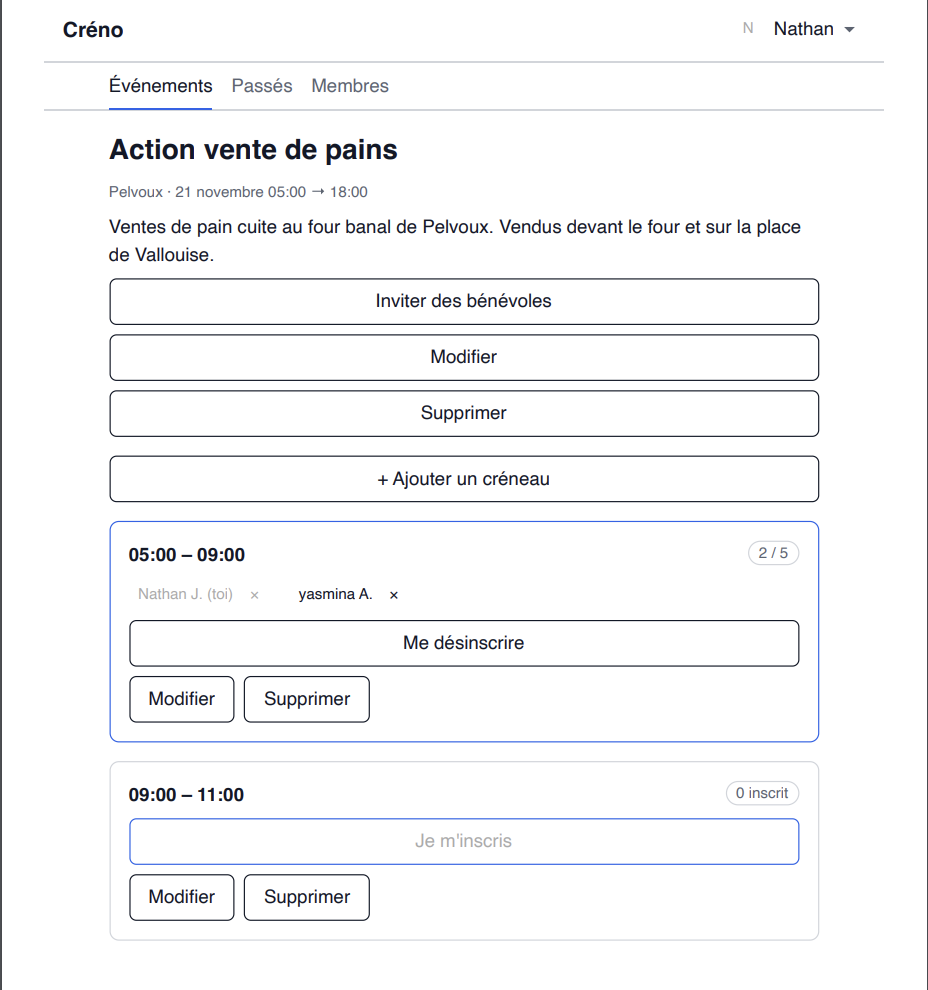
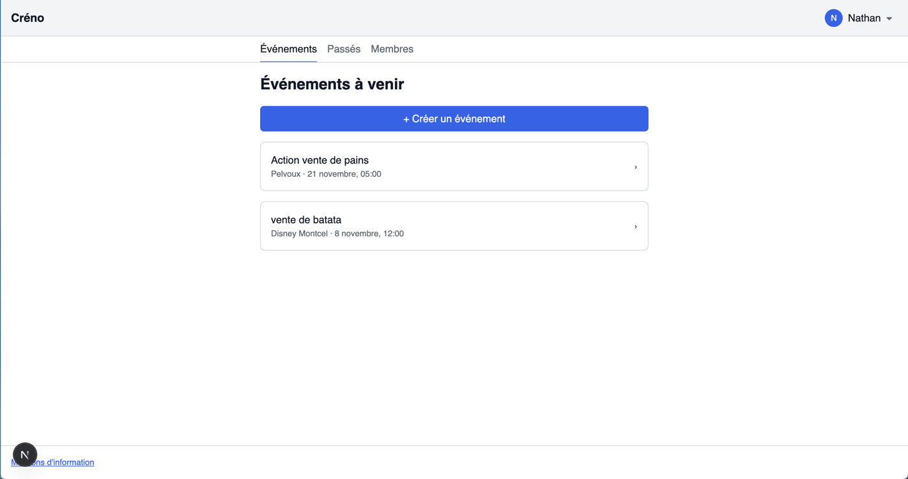
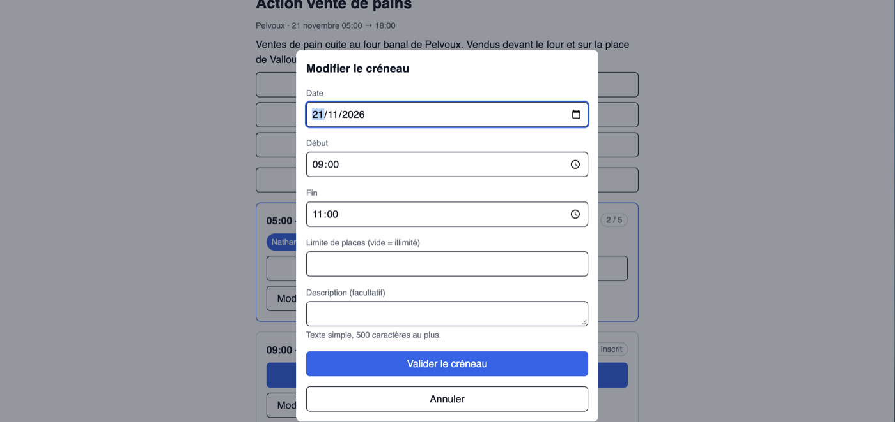

# Créno

**Créno est une application web libre de gestion de bénévoles pour les associations** : l'administrateur publie des événements avec des créneaux, les bénévoles s'y inscrivent depuis leur téléphone, et chacun voit le remplissage des créneaux. Elle remplace les formulaires et les tableurs partagés.

[English summary](#english-summary) · [Documentation](docs/) · [Contribuer](CONTRIBUTING.md) · [Sécurité](SECURITY.md)

<p align="center"></p>

## Pourquoi Créno ?

Beaucoup d'associations organisent leurs bénévoles avec un Google Form, un tableur partagé ou un sondage (Doodle, Framadate). Ces outils ne gèrent pas bien les **créneaux avec un nombre de places limité** : on ne voit pas qui est inscrit, on ne peut pas modifier sa réponse seul, et l'organisateur recompte à la main.

| Alternative                                                            | Pourquoi elle atteint ses limites pour des bénévoles                                                       |
| ---------------------------------------------------------------------- | ---------------------------------------------------------------------------------------------------------- |
| Google Forms (formulaire d'inscription)                                | Pas de créneaux à places limitées, pas de liste visible des inscrits, une réponse se modifie difficilement |
| Tableur partagé (Excel, Google Sheets)                                 | Chacun peut écraser la ligne d'un autre, pas de limite de places fiable, pas de comptes                    |
| Doodle, Framadate (sondages de dates)                                  | Conçus pour choisir une date, pas pour répartir des bénévoles sur plusieurs créneaux                       |
| Logiciels de planning en ligne (SignUpGenius, BenevolOps, RosterThat…) | Services hébergés chez un tiers, souvent payants au-delà d'une offre limitée                               |
| [ephios](https://github.com/ephios-dev/ephios) (libre)                 | Libre lui aussi, orienté plannings d'équipes de secours : à comparer selon votre besoin                    |

Créno est pensé pour une association, pas pour une grande ONG :

- **Simple** : pas de compte à créer sur un service tiers, un lien d'invitation suffit.
- **Mobile d'abord** : conçu pour un écran de 360 px.
- **Auto-hébergé** : une instance = une association, vos données restent chez vous (RGPD : suppression de compte, rectification).
- **Gratuit et libre** : pas d'abonnement, du code ouvert et une documentation complète.

## Fonctionnalités

**Pour l'administrateur**

- Installer l'instance (club et premier administrateur) en quelques minutes.
- Créer des événements avec des créneaux (horaires, nombre de places limité ou non, description).
- Inviter des bénévoles par un lien d'invitation généré depuis un événement.
- Suivre le remplissage de chaque créneau, retirer un inscrit.
- Gérer les membres : droit d'administrateur, lien de réinitialisation de mot de passe.

**Pour le bénévole**

- Créer son compte depuis un lien d'invitation, se connecter par e-mail et mot de passe.
- Consulter les événements, voir qui est inscrit et les places restantes.
- S'inscrire, se désinscrire ou changer de créneau seul.
- Consulter et modifier son profil, supprimer son compte et ses données.

Le périmètre exact, les priorités et la suite sont dans [`docs/prd.md`](docs/prd.md) et [`docs/roadmap.md`](docs/roadmap.md).

## Aperçu

**La liste des événements à venir**



**Un événement et ses créneaux** : inscrits, places restantes, inscription et désinscription en un clic.


**La modification d'un créneau** : horaires, limite de places facultative, description.



## Démarrage rapide

Prérequis : Node.js 20.19 ou plus, pnpm 10 (`corepack enable`), Docker.

```
pnpm install && cp .env.example .env   # puis remplir les valeurs de .env
docker compose up -d db
pnpm db:migrate && pnpm db:seed
pnpm dev                               # http://localhost:3000
```

Pour installer Créno sur un serveur, voir [Mise en production](#mise-en-production).

## Technologies

TypeScript, Next.js, Prisma, PostgreSQL, Zod, Tailwind, Docker. Les choix et les alternatives écartées sont dans [`docs/adr/`](docs/adr/).

## Contribuer

Les contributions sont bienvenues : rapports de bugs, idées, documentation, code. Lisez [`CONTRIBUTING.md`](CONTRIBUTING.md) et le [code de conduite](CODE_OF_CONDUCT.md). Pour signaler une faille de sécurité, voir [`SECURITY.md`](SECURITY.md).

## English summary

**Créno** is a free, self-hosted web app that helps nonprofits and clubs organise volunteers. An administrator publishes events with time slots (optionally limited in places); volunteers sign up, change or cancel their registration on their own from a phone, and everyone sees how full each slot is. It replaces forms and shared spreadsheets. One instance serves one association; the interface is in French; GDPR-friendly (account deletion and rectification).

Stack: TypeScript, Next.js, Prisma, PostgreSQL, Docker. Quick start: see [Démarrage rapide](#démarrage-rapide). The code and comments are in English, the documentation in French. Contributions are welcome: see [`CONTRIBUTING.md`](CONTRIBUTING.md).

## Développement

### Commandes

| But           | Commande                                                            |
| ------------- | ------------------------------------------------------------------- |
| Installer     | `pnpm install`                                                      |
| Configurer    | copier `.env.example` en `.env` et remplir les valeurs              |
| Lancer        | `pnpm dev` (http://localhost:3000)                                  |
| Qualité       | `pnpm lint`, `pnpm typecheck`                                       |
| Base locale   | `docker compose up -d db`, puis `pnpm db:migrate` et `pnpm db:seed` |
| Tests         | `pnpm test` (`test:unit`, `test:integration`)                       |
| Contrat d'API | `pnpm api:generate`, `pnpm api:check`, `pnpm api:lint`              |

Après un `git pull` qui touche `apps/web/prisma/`, relancer `pnpm db:migrate` : il applique les migrations et régénère le client Prisma (sans cela, le client est périmé et les routes répondent `500`). Redémarrer ensuite `pnpm dev`. En production, l'image `migrate` n'exécute que `pnpm db:deploy` ; le client est généré au build.

L'application refuse de démarrer si une variable d'environnement obligatoire manque ou est invalide (`docs/architecture/environments.md`).

La documentation complète est dans `docs/` ; le plan de développement dans `docs/roadmap.md`.

## Mise en production

Une instance = une association. Prérequis : un serveur avec Docker et Docker Compose, un nom de domaine dont l'adresse pointe vers ce serveur, les ports 80 et 443 ouverts.

1. Récupérer le dépôt (ou seulement `docker-compose.yml` et `deploy/Caddyfile`) sur le serveur.
2. Copier `.env.example` en `.env`, le remplir (droits `chmod 600 .env`) :
   - `POSTGRES_USER`, `POSTGRES_PASSWORD`, `POSTGRES_DB` : choisir une valeur, le mot de passe sans caractère spécial d'URL (`@ : / ? #`) ;
   - `DATABASE_URL` : inutilisée par `docker compose` (il la construit), à remplir pour le travail local ;
   - `AUTH_SECRET` : 32 octets aléatoires au minimum (`openssl rand -base64 48`) ;
   - `DOMAIN` (par exemple `benevoles.mon-club.fr`) et `APP_URL` (`https://` + domaine) ;
   - `TRUST_PROXY=true`, `LOG_LEVEL=info` ;
   - `BACKUP_ENCRYPTION_KEY` : la clé **publique** `age` (voir « Sauvegardes ») ;
   - `CRENO_VERSION` : le numéro de la version publiée, par exemple `0.1.0` pour le tag `v0.1.0`.
3. `docker compose up -d` : PostgreSQL démarre, le service `migrate` applique les migrations une fois, puis l'application et Caddy (HTTPS automatique, redirection du HTTP) démarrent.
4. Vérifier : `curl https://<domaine>/health` répond `{"status":"ok"}`.
5. Ouvrir l'adresse dans un navigateur et remplir tout de suite la page d'installation (club et premier administrateur, RG-17).

**Mettre à jour** : `deploy/update.sh 0.2.0` (version = tag sans le `v`). Le script fait une sauvegarde `pre-update`, change `CRENO_VERSION` dans `.env`, récupère les images, démarre (le service `migrate` s'exécute avant l'application) et interroge `/health`. Équivalent à la main : `deploy/backup.sh pre-update`, modifier `CRENO_VERSION`, `docker compose pull`, `docker compose up -d --wait`, `curl https://<domaine>/health`.

**Revenir en arrière** (incident après une mise à jour ; `X` = version précédente, `Y` = version installée) :

1. Si la mise à jour contenait une migration réversible : `docker compose run --rm migrate pnpm db:rollback` (avec `CRENO_VERSION=Y` encore dans `.env`, car le script de retour est dans l'image `Y`). Elle défait la dernière migration. Répéter pour chaque migration de la version, de la plus récente à la plus ancienne.
2. Mettre `CRENO_VERSION=X` dans `.env`, puis `docker compose pull && docker compose up -d`.
3. Vérifier `curl https://<domaine>/health` et ouvrir une page.
4. Si une migration détruit des données (marquée irréversible dans sa pull request) : à la place de l'étape 1, restaurer la sauvegarde `pre-update` (voir « Restaurer »), puis faire l'étape 2.

## Sauvegardes, restauration, purge et supervision

Détails et choix : `docs/architecture/environments.md`, section 5.

**Préparer le chiffrement (une fois, sur votre ordinateur, pas sur le serveur)**

1. Installer `age` (`brew install age`, `apt install age`), puis `age-keygen -o creno-backup.key`. La ligne `# public key: age1…` s'affiche : c'est la valeur de `BACKUP_ENCRYPTION_KEY`.
2. Ranger `creno-backup.key` (la clé **privée**) dans un gestionnaire de mots de passe et en garder une deuxième copie ailleurs. Sans elle, les sauvegardes sont illisibles ; le serveur ne l'a jamais.
3. Sur le serveur, installer aussi `age` (le script chiffre avec la clé publique).

**Planifier (sur le serveur, `crontab -e`, depuis le dossier du dépôt)**

```
15 3 * * * cd /opt/creno && deploy/backup.sh >> /var/log/creno-backup.log 2>&1
45 3 * * * cd /opt/creno && docker compose --profile tools run --rm purge >> /var/log/creno-purge.log 2>&1
```

La première ligne crée une sauvegarde `backups/creno-<date>-daily.dump.age` : 7 jours conservés, plus la première de chaque mois pendant 12 mois (`backups/monthly/`). La seconde supprime les tentatives de connexion sans blocage depuis plus de 24 h et les jetons de réinitialisation expirés ou utilisés depuis plus de 30 jours.

**Restaurer** (perte ou corruption de la base) : copier la clé privée sur le serveur le temps de l'opération, puis

```
deploy/restore.sh backups/creno-<date>-daily.dump.age /chemin/creno-backup.key
curl https://<domaine>/health
```

puis supprimer la clé privée du serveur. Le script arrête l'application, recharge la base et redémarre. **Tester sans risque** (à faire avant la première mise en service, puis tous les 6 mois) : `RESTORE_DB=creno_essai deploy/restore.sh <sauvegarde> <clé>` recharge la sauvegarde dans une base d'essai sans toucher à la production ; la vérifier avec `docker compose exec db psql -U <POSTGRES_USER> -d creno_essai -c "select count(*) from users"`, puis `docker compose exec db dropdb -U <POSTGRES_USER> creno_essai`.

**Alerte de disponibilité** : créer un moniteur gratuit (par exemple UptimeRobot, offre gratuite) de type HTTP(s) sur `https://<domaine>/health`, intervalle 5 minutes, alerte par e-mail à un responsable. `/health` répond 200 si l'application et la base répondent, 503 sinon.

**Journaux** : chaque conteneur garde au plus 5 fichiers de 10 Mo (`docker-compose.yml`) ; lire avec `docker compose logs --tail 100 app`. Aucun mot de passe, jeton ni e-mail complet n'y figure.

**Essayer en local sans publier** : `docker compose build`, puis `docker compose up -d` avec un `.env` dont `DOMAIN=localhost`, `APP_URL=https://localhost`, `TRUST_PROXY=true` et `BACKUP_ENCRYPTION_KEY` rempli ; ouvrir `https://localhost/health` (certificat local de Caddy, à accepter).

## Intégration continue et versions

La chaîne `.github/workflows/ci.yml` s'exécute sur chaque pull request et chaque fusion dans `main` : fichiers générés à jour (tokens, `pnpm api:check`), lint, types, tests unitaires, tests d'intégration sur PostgreSQL jetable (dont migration appliquée, défaite, rejouée), scan de secrets (gitleaks), audit des dépendances. Sur `main`, l'image Docker est aussi construite (non publiée).

**Publier une version** : créer un tag `vX.Y.Z` sur `main` (`git tag v0.1.0 && git push origin v0.1.0`). La chaîne publie les images `ghcr.io/<propriétaire>/creno:X.Y.Z` et `ghcr.io/<propriétaire>/creno-migrate:X.Y.Z` (jamais `latest`) et crée les notes de version. Si le paquet est privé, `docker login ghcr.io` est nécessaire sur le serveur ; sinon, le rendre public dans les réglages du paquet.

**Protéger `main`** (réglage GitHub, à faire une fois par le propriétaire du dépôt) : Settings → Branches → Add branch ruleset (ou règle de protection) sur `main`, avec :

- _Require a pull request before merging_ (une approbation) ;
- _Require status checks to pass_ : `Quality and unit tests`, `Integration tests and migrations`, `End-to-end tests`, `Secret scan`, `Dependency audit` ;
- _Require branches to be up to date before merging_ ;
- _Block force pushes_ et _Restrict deletions_.

Dependabot propose chaque semaine les mises à jour npm (groupées) et chaque mois celles des actions GitHub et des images Docker ; elles passent par la même chaîne.
